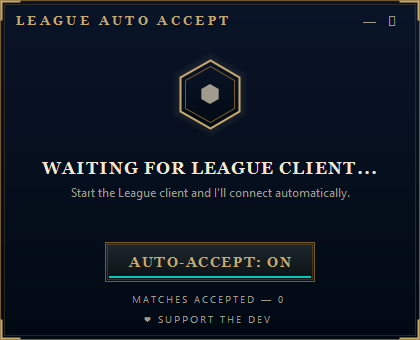

# League Auto Accept

A tiny Windows app that automatically accepts the League of Legends
**"Match Found"** ready check — so you can grab food, stretch, or take a
bathroom break without missing your queue pop.



## Features

- ⚡ **Instant accept** — fires the moment the ready check appears, even with the client minimized
- 🖥️ **Hextech-styled window** — live status (waiting / in queue / accepted), an ON/OFF toggle, and a session counter
- 🔔 **System tray mode** — close the window and it keeps watching from the tray, with a Windows notification when it accepts
- 🪶 **Light on resources** — no overlay, no game hooks, just a 1-second poll of the client's local API
- 📦 **No Java needed** — the installer bundles a trimmed runtime

## Download

Grab the latest `LeagueAutoAccept-Setup-x.x.x.exe` from the
[Releases page](../../releases). It installs per-user (no admin rights
needed) with optional desktop shortcut and start-with-Windows.

> **SmartScreen note:** the installer isn't code-signed, so Windows may show
> "Windows protected your PC" the first time. Click **More info → Run anyway**.

## How it works

The League client runs a local REST API (the LCU API) on
`https://127.0.0.1:<port>`. This app:

1. Finds the running `LeagueClientUx.exe` process and reads the API port
   and auth token from its command line (with the `lockfile` in the default
   install folder as a fallback).
2. Polls `GET /lol-gameflow/v1/gameflow-phase` once a second to track what
   the client is doing.
3. When the phase hits `ReadyCheck` (and you haven't answered yet), it fires
   `POST /lol-matchmaking/v1/ready-check/accept`.

No pixel detection, no game memory access, nothing sent anywhere — it talks
only to the client's own local API, the same one the client UI uses.

## Building from source

Requirements: Windows, JDK 21+ (e.g. Eclipse Temurin). No other dependencies —
the app is pure Java/Swing.

```bat
build.bat   &:: compile
run.bat     &:: launch
```

To build the distributable installer (additionally requires Inno Setup 6):

```bat
package.bat
```

Produces `dist\LeagueAutoAccept-Setup-x.x.x.exe` with a trimmed Java runtime
bundled via `jpackage`.

## Support

If this app saved your queue, you can [buy me a coffee on Ko-fi](https://ko-fi.com/tolu_aina) ♥
It's also linked from the app's footer and tray menu.

## Disclaimer

League Auto Accept isn't endorsed by Riot Games and doesn't reflect the views
or opinions of Riot Games or anyone officially involved in producing or
managing Riot Games properties. Riot Games, and all associated properties are
trademarks or registered trademarks of Riot Games, Inc.

The LCU API is unofficial and unsupported; endpoints may change at any time.
Use at your own risk.

## License

[MIT](LICENSE)
